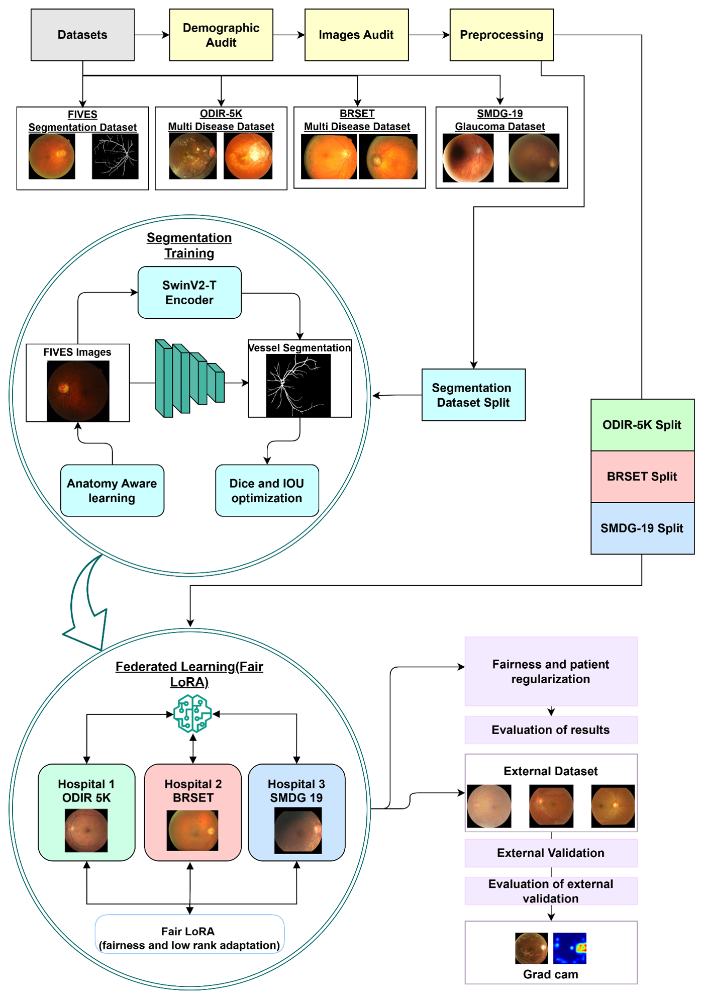
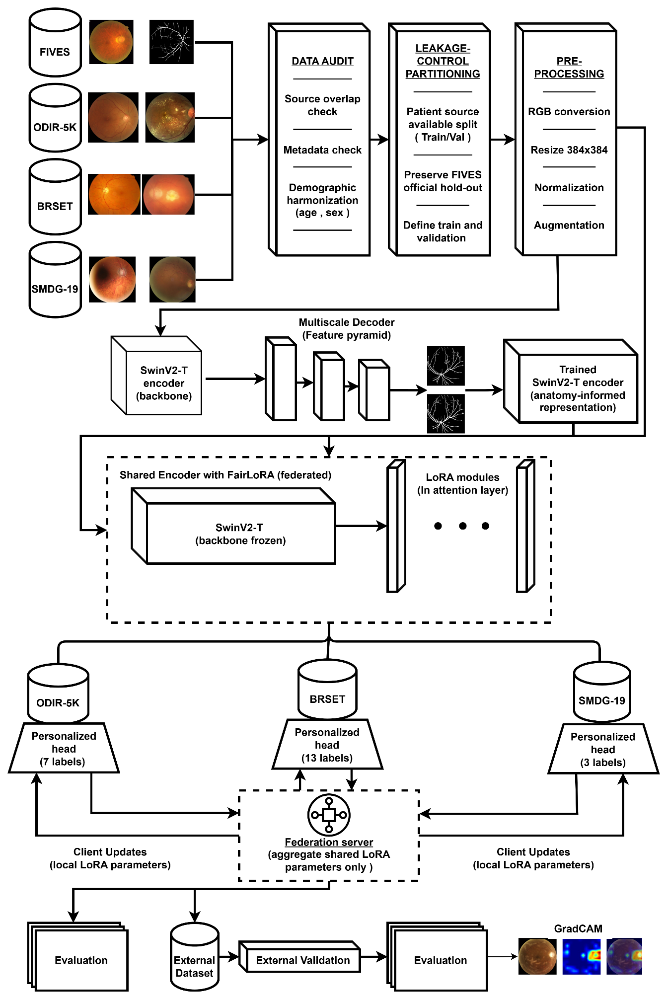
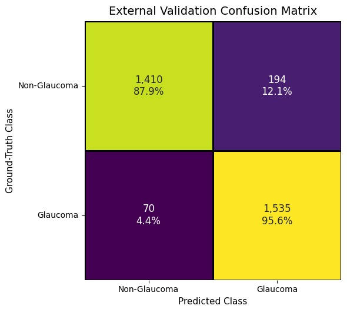
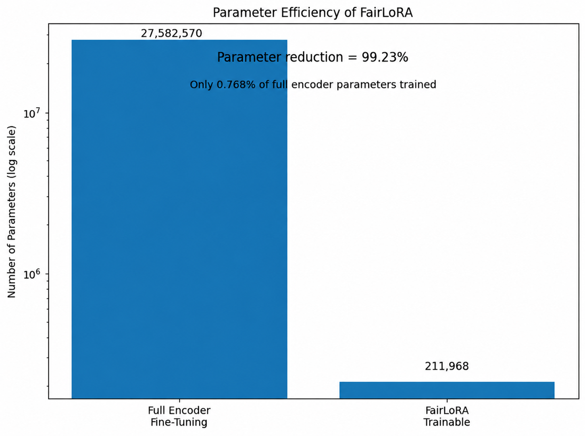
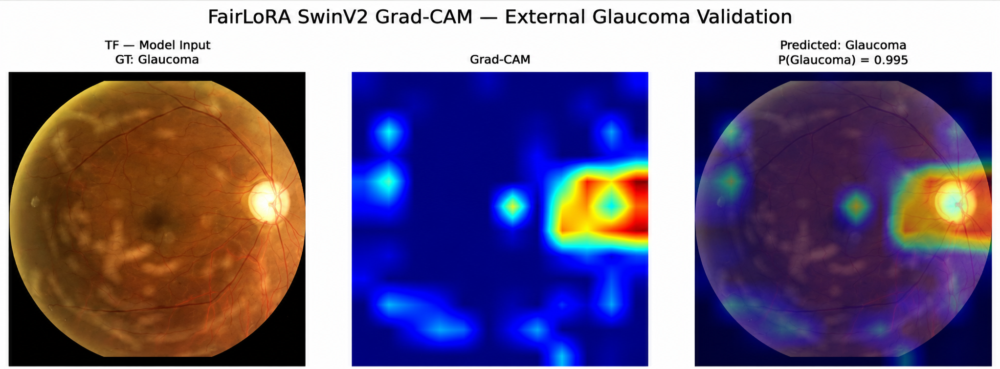

# FairLoRA: Fairness-Aware Federated Learning for Retinal Fundus Analysis

A research implementation of a fairness-aware, parameter-efficient federated learning framework for heterogeneous retinal fundus analysis. The pipeline combines anatomy-aware SwinV2-T representation learning, FairLoRA attention adaptation, age- and sex-aware fairness regularization, client-specific classification heads, and independent external glaucoma evaluation.

---

## Overview

The proposed framework integrates:

- FIVES-based retinal-vessel segmentation to initialize an anatomy-aware SwinV2-T encoder.
- Three heterogeneous federated clients: ODIR-5K, BRSET, and SMDG-19.
- Low-Rank Adaptation (LoRA) in SwinV2-T attention query-key-value and output projections.
- Client-specific prediction heads for different label spaces.
- Age- and sex-aware demographic-parity and equalized-odds regularization.
- Independent external glaucoma evaluation and Grad-CAM-based visual interpretation.
- Leakage-conscious image auditing, dataset partitioning, and preprocessing.

The implementation is organized into three sequential scripts: data preparation and vessel-segmentation adaptation, federated FairLoRA training, and external validation/evaluation.

---

## Framework Architecture

The first diagram presents the complete research workflow, from dataset auditing and anatomy-aware representation learning to federated learning, external validation, and interpretation.

<p align="center">
  
</p>

The second diagram details the model and federated architecture, including the shared SwinV2-T encoder, low-rank attention modules, personalized client heads, and server-side aggregation of LoRA parameters.

<p align="center">
  
</p>

---

## End-to-End Experimental Pipeline

The experimental workflow consists of three stages:

1. **Data preparation and anatomical adaptation:** Download and audit the development datasets, prepare image and metadata manifests, create data splits, and train SwinV2-T for retinal-vessel segmentation using FIVES.
2. **Federated FairLoRA training:** Initialize the shared encoder from the FIVES-adapted representation and train ODIR-5K, BRSET, and SMDG-19 clients using shared LoRA parameters and local classification heads.
3. **External validation and interpretation:** Restore the selected federated model, audit image-level overlap against development images, evaluate the external glaucoma cohort, and generate performance figures and a Grad-CAM example.

---

## Datasets

The four development datasets and one external evaluation dataset are used for separate roles in the pipeline.

| Dataset | Role in this framework | Learning task | Source |
|---|---|---|---|
| FIVES | Anatomy-aware representation learning | Retinal-vessel segmentation | [Kaggle](https://www.kaggle.com/datasets/nikitamanaenkov/fundus-image-dataset-for-vessel-segmentation) |
| ODIR-5K | Federated client 1 | Multi-label ocular disease classification (7 retained labels) | [Kaggle](https://www.kaggle.com/datasets/andrewmvd/ocular-disease-recognition-odir5k) |
| BRSET patient-wise split | Federated client 2 | Multi-label retinal disease classification (13 labels) | [Kaggle](https://www.kaggle.com/datasets/tanzinabdul/fundus-patientwise-split) |
| SMDG-19 | Federated client 3 | Three-class glaucoma classification | [Kaggle](https://www.kaggle.com/datasets/deathtrooper/multichannel-glaucoma-benchmark-dataset) |
| Unified Fundus Images for Glaucoma | Independent external evaluation only | Binary glaucoma evaluation | [Kaggle](https://www.kaggle.com/datasets/jeremypoveda/dataset-unified-fundus-images-for-glaucoma) |

The scripts use KaggleHub dataset handles. Dataset access may require Kaggle authentication and acceptance of the relevant dataset terms. Do not upload raw datasets, demographic metadata, Kaggle credentials, or API tokens to this repository.

---

## Methodology

### 1. Leakage-Controlled Data Preparation

The first script audits the source files and metadata, checks image-mask relationships, excludes identified source overlaps where specified in the implementation, converts fundus images to RGB, and resizes inputs to 384 × 384 pixels. Fundus images use high-quality LANCZOS resizing, while vessel masks use nearest-neighbor resizing followed by binary thresholding.

FIVES is divided into 540 training, 60 validation, and 200 official test image-mask pairs. Patient-aware or source-aware grouping is applied to the federated datasets before the train/validation split.

### 2. Vessel-Aware Representation Learning

A SwinV2-T encoder initialized with ImageNet-1K weights is adapted using supervised FIVES retinal-vessel segmentation. A multi-scale decoder is used during segmentation training. The downstream federated stage transfers the selected encoder feature weights; the segmentation decoder is not used as a federated classifier component.

### 3. Heterogeneous Federated FairLoRA

The vessel-adapted SwinV2-T feature hierarchy is frozen and low-rank adapters are registered in attention QKV and output projections. The three clients retain separate prediction heads because their label spaces and tasks differ:

- **ODIR-5K:** 7-label multi-label classification.
- **BRSET:** 13-label multi-label classification.
- **SMDG-19:** 3-class glaucoma classification (non-glaucoma, suspect, glaucoma).

Only shared LoRA parameters are aggregated by sample-size-weighted federated averaging. Client-specific classification heads remain local to their respective clients.

### 4. Demographic Fairness Regularization

Age and sex are treated as protected attributes in the differentiable fairness objective. The implementation combines demographic-parity score gaps with outcome-conditioned score gaps related to the equalized-odds principle. Missing protected attributes are excluded from the corresponding fairness calculation rather than imputed.

### 5. External Glaucoma Evaluation and Grad-CAM

The selected federated checkpoint is evaluated on the Unified Fundus Images for Glaucoma dataset without additional model fine-tuning or external threshold optimization. The binary decision uses a fixed glaucoma probability threshold of 0.50 in the supplied evaluation script. Grad-CAM is generated from the predicted-class logit using the final spatial SwinV2-T representation before global pooling.

---

## Key Results

The following results are transcribed from the accompanying manuscript. They are reported study results, not results generated by simply installing or running this repository.

### Independent External Validation

| Metric | Reported value |
|---|---:|
| Accuracy | 91.77% |
| Precision | 88.78% |
| Sensitivity / Recall | 95.64% |
| Specificity | 87.91% |
| F1-score | 92.08% |

The external confusion matrix reported in the manuscript is shown below.

<p align="center">
  
</p>

### Parameter Efficiency

| Strategy | Trainable encoder parameters |
|---|---:|
| Full encoder fine-tuning | 27,582,570 |
| FairLoRA | 211,968 |

This corresponds to a reported 99.23% reduction in trainable encoder parameters.

<p align="center">
  
</p>

### Demographic Fairness

The table reports client-wise demographic-parity (DP) and equalized-odds-related (EO) score gaps from the manuscript.

| Configuration | Client | Sex DP | Sex EO | Age DP | Age EO |
|---|---|---:|---:|---:|---:|
| Without fairness | ODIR-5K | 0.048 | 0.071 | 0.085 | 0.079 |
| Without fairness | BRSET | 0.118 | 0.059 | 0.162 | 0.124 |
| Without fairness | SMDG-19 | 0.082 | 0.165 | 0.174 | 0.160 |
| FairLoRA | ODIR-5K | 0.017 | 0.032 | 0.032 | 0.030 |
| FairLoRA | BRSET | 0.064 | 0.022 | 0.087 | 0.066 |
| FairLoRA | SMDG-19 | 0.030 | 0.094 | 0.096 | 0.091 |

### Ablation Study

| Model configuration | Accuracy (%) | Precision (%) | Sensitivity (%) | Specificity (%) | F1 (%) |
|---|---:|---:|---:|---:|---:|
| Without FIVES adaptation | 89.15 | 86.20 | 92.40 | 85.60 | 89.19 |
| Without fairness regularization | 92.10 | 89.25 | 95.80 | 88.05 | 92.41 |
| Without federated aggregation | 88.60 | 85.50 | 91.80 | 85.10 | 88.54 |
| Full encoder fine-tuning | 90.85 | 87.65 | 94.10 | 87.20 | 90.76 |
| Proposed FairLoRA | 91.77 | 88.78 | 95.64 | 87.91 | 92.08 |

### Grad-CAM Interpretation

The manuscript includes a correctly classified external glaucoma case with a Grad-CAM activation map and overlay. Grad-CAM is a qualitative model-attribution visualization and should not be interpreted as clinical proof.

<p align="center">
  
</p>

---

## Installation

Clone the repository and create a Python environment:

```bash
git clone https://github.com/<YOUR-GITHUB-USERNAME>/fairlora-retinal-federated-learning.git
cd fairlora-retinal-federated-learning
python -m venv .venv
```

Activate the environment.

**Windows PowerShell**

```powershell
.venv\Scripts\Activate.ps1
```

**Linux / macOS**

```bash
source .venv/bin/activate
```

Install PyTorch and Torchvision as a compatible pair for your CUDA/runtime environment using the official [PyTorch installation selector](https://pytorch.org/get-started/locally/). Then install the remaining packages:

```bash
python -m pip install --upgrade pip
pip install -r requirements.txt
```

---

## Experimental Environment

The manuscript reports the following experimental configuration:

- Development environment: Google Colab.
- GPU: NVIDIA L4 with 22.03 GB available GPU memory.
- Framework: PyTorch and Torchvision.
- Base architecture: SwinV2-T.
- Input image resolution: 384 × 384 RGB.
- Mixed precision: bfloat16.
- LoRA rank: 8.
- LoRA scaling coefficient (alpha): 16.
- Local epochs per federated round: 2.
- Fairness regularization coefficient: 0.05.
- Random seed in the supplied scripts: 42.

A CUDA-capable GPU is recommended. Runtime memory and training time will depend on batch sizes, worker settings, and the available hardware.

---

## Repository Structure

```text
fairlora-retinal-federated-learning/
├── Results/
│   ├── README.md
│   ├── external_validation_metrics.csv
│   ├── external_confusion_matrix.csv
│   ├── parameter_efficiency.csv
│   ├── demographic_fairness_gaps.csv
│   └── ablation_study.csv
├── figures/
│   ├── fig1.png
│   ├── fig2.png
│   ├── fig3.png
│   ├── fig23.png
│   ├── fig24.png
│   └── paper_figures/
│       ├── FIGURE_INDEX.md
│       ├── figure-01.png
│       ├── figure-02.png
│       ├── ...
│       └── figure-24.png
├── 01_data_download_and_segmentation.py
├── 02_federated_fairlora.py
├── 03_external_validation_evaluation.py
├── README.md
├── requirements.txt
└── .gitignore
```

The `figures/` directory contains selected visuals for the README and all 24 figure assets extracted from the supplied manuscript. The `Results/` CSV files contain manuscript-reported values for convenient reference. Actual run outputs are written to the experiment root described below; large checkpoints and datasets should not be committed to Git.

---

## Running the Pipeline

Run the three scripts in sequence. Use the same experiment `--root` for all stages.

### 1. Data Download, Preprocessing, and FIVES Segmentation

```bash
python 01_data_download_and_segmentation.py \
  --root ./fairlora_retinal_project \
  --epochs 30 \
  --batch-size 8 \
  --workers 4
```

This script downloads FIVES, ODIR-5K, BRSET, and SMDG-19 through KaggleHub, prepares images and manifests, creates splits and group-split audits, and trains the FIVES vessel-segmentation model. The default segmentation training length is 30 epochs.

Useful options:

- `--skip-download`: use datasets that have already been downloaded into the expected raw-data folders.
- `--skip-segmentation`: run data preparation and split generation without training the segmentation model.

### 2. Federated FairLoRA Training

```bash
python 02_federated_fairlora.py \
  --root ./fairlora_retinal_project \
  --rounds 30 \
  --local-epochs 2 \
  --batch-size 16 \
  --fairness-batch-size 64 \
  --workers 4
```

This stage requires the vessel-adapted encoder checkpoint created in Stage 1. It trains the ODIR-5K, BRSET, and SMDG-19 clients and aggregates shared LoRA parameters while retaining personalized client heads. Training can resume from the last federated checkpoint. Use `--fresh` to clear existing federated checkpoints and history before starting again.

### 3. External Glaucoma Evaluation

```bash
python 03_external_validation_evaluation.py \
  --root ./fairlora_retinal_project \
  --batch-size 32 \
  --workers 4
```

By default, the external dataset is downloaded through KaggleHub. To use an existing local copy:

```bash
python 03_external_validation_evaluation.py \
  --root ./fairlora_retinal_project \
  --data-root /path/to/unified_fundus_glaucoma_dataset \
  --batch-size 32 \
  --workers 4
```

The external dataset must contain a `test/` folder with `glaucoma/` and `non_glaucoma/` image folders. External evaluation requires the completed FIVES encoder and federated checkpoints from the previous stages.

---

## Generated Outputs

The scripts write data, checkpoints, manifests, metrics, and plots under the chosen experiment root, not into the GitHub repository by default. The generated structure includes:

```text
fairlora_retinal_project/
├── data/
│   ├── raw/
│   └── processed/
├── splits/
├── checkpoints/
│   ├── fives_segmentation/
│   └── federated/
└── reports/
    ├── segmentation/
    ├── federated/
    └── external_validation/
        └── figures/
```

The external stage saves a prediction file, metrics in CSV/JSON formats, an image-overlap audit, confusion matrix, ROC and precision-recall plots where calculable, a metrics summary visualization, and a Grad-CAM example.

---

## Reproducibility Notes

1. Keep the same `--root` path across all three stages. The first script writes absolute image paths into manifests; moving the prepared data directory may require regenerating the manifests.
2. The scripts use fixed seed 42. Exact results may still vary with software, hardware, data versions, and runtime behavior.
3. The supplied federated implementation simulates three dataset-defined clients within one Python process. It is not a deployed multi-hospital service and does not implement secure aggregation or transport encryption.
4. The external overlap audit checks exact standardized-pixel and perceptual-hash image matches. The external folder does not provide sufficient patient/source metadata to verify patient-level or source-level independence.
5. Grad-CAM example selection uses external ground-truth labels to choose a correctly classified glaucoma-positive case; the heatmap itself is computed from the predicted-class logit.
6. The three supplied scripts implement the main pipeline. They do not provide an automated runner for every ablation configuration reported in the manuscript.
7. The results committed under `Results/` are transcribed from the manuscript and should not be presented as outputs from a fresh run of the code.

---

## README Figures and Paper Figures

The GitHub README displays five principal figures: the overall framework, detailed federated architecture, parameter-efficiency comparison, external confusion matrix, and Grad-CAM example. All 24 manuscript figure assets are retained in `figures/paper_figures/` for reference.

Before making the repository public, verify that the source dataset terms permit redistribution of figures containing fundus photographs. Linking to a dataset is not the same as obtaining permission to redistribute its images.

---

## Citation

If you use this implementation, cite the associated research manuscript. The supplied manuscript copy does not provide finalized bibliographic metadata in a citation-ready title/author/venue block. Add the confirmed manuscript title, author list, journal or conference, year, and DOI here when finalized.

---

## Disclaimer

This repository is intended for research and educational use. It is not a medical device and must not be used as a standalone diagnostic system or for clinical decision-making. Further external, prospective, and multi-institutional validation is required before any clinical use can be considered.

## License

No license has been assigned in this starter repository. Confirm code ownership and third-party data/figure permissions before adding a license or making the repository public.
